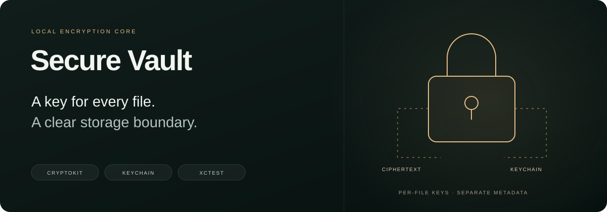
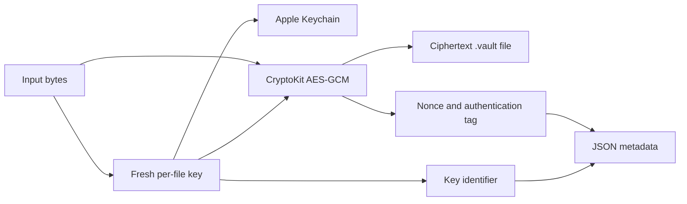

<p align="center"></p>
<p align="center">
  <a href="https://github.com/KhalidD0nc/Secure-Vault/actions/workflows/ci.yml"></a>
  
  
  
  
</p>
<p align="center"><strong>Per-file encryption, device-local keys, and a testable storage lifecycle.</strong></p>
<p align="center">
  <a href="#implemented-core">Capabilities</a> · <a href="#open-and-run">Setup</a> ·
  <a href="docs/ARCHITECTURE.md">Architecture</a> · <a href="#tests">Tests</a> ·
  <a href="CONTRIBUTING.md">Contributing</a>
</p>

Secure Vault is an iOS prototype focused on the file-encryption layer: generate a fresh symmetric key for each item, store that key in the Apple Keychain, persist ciphertext and metadata separately, and recover the original bytes when needed.

The cryptography and storage services are implemented and covered by XCTest cases. The SwiftUI application currently displays a starter screen; a vault browser, file-picker flow, and biometric unlock interface have not been connected to this core. The banner illustrates the architecture rather than a finished app screen.

## Implemented core

| Area | Current behavior |
| --- | --- |
| Encryption | AES-256-GCM sealing and authenticated opening through CryptoKit |
| Key management | One fresh 256-bit key and a UUID key identifier per new item |
| Key storage | Generic-password Keychain items with `WhenUnlockedThisDeviceOnly` accessibility |
| Persistence | Separate ciphertext blobs and JSON metadata under Application Support |
| Import | Read a file, encrypt it, and optionally attempt removal of the original |
| Read | Decrypt into memory or create a caller-managed temporary plaintext file |
| Lifecycle | Load item metadata and delete the key plus stored item files |

## Data flow



Raw key bytes stay in Keychain. Metadata contains the key identifier, nonce, tag, display name, content type, size, and creation time. Metadata itself is stored as unencrypted JSON. See [storage layout and lifecycle details](docs/ARCHITECTURE.md).

## Open and run

Use **Xcode 26.5 or newer** with its iOS platform support and an iOS 26-or-newer simulator. The app and test targets declare an iOS 26.0 deployment target; the project was created with Xcode 26.5.

```bash
git clone https://github.com/KhalidD0nc/Secure-Vault.git
cd Secure-Vault
open Secure-Vault.xcodeproj
```

Select the shared **Secure-Vault** scheme, choose an iPhone simulator, and run. For a physical device, select your own development team under Signing & Capabilities. The project uses Apple's system frameworks and has no third-party package dependencies or API credentials to configure.

Running the app opens the current starter SwiftUI screen. Use the tests to exercise the implemented encryption and storage flows.

## Use the storage core

Within the application target:

```swift
let vault = try VaultFileCryptoService()
let item = try vault.encryptAndStore(
    data: Data("A private note".utf8),
    displayName: "note.txt",
    contentType: "text/plain"
)
let recovered = try vault.decryptData(for: item)
assert(recovered == Data("A private note".utf8))
```

The default service stores files under the app's Application Support directory. Tests supply a temporary base directory and a unique Keychain service namespace.

## Tests

In Xcode, use **Product → Test**. From a terminal:

```bash
xcrun simctl list devices available

# Replace DEVICE_UDID with an available iOS 26+ simulator identifier
xcodebuild test \
  -project Secure-Vault.xcodeproj \
  -scheme Secure-Vault \
  -destination 'platform=iOS Simulator,id=DEVICE_UDID' \
  -parallel-testing-enabled NO
```

| Suite | Coverage |
| --- | --- |
| `CryptoServiceTests` | Round-trip encryption, ciphertext inequality, tampered ciphertext/tag, wrong key, and wrong nonce |
| `KeychainServiceTests` | Store/read, missing entries, duplicate rejection, deletion, and idempotent deletion |
| `VaultFlowTests` | Encrypted file persistence, recovery, source removal, tampering, deletion, and metadata reload |

CI runs the project on an iPhone simulator using a macOS 26 runner and ad hoc simulator signing so Keychain tests retain the app's signing entitlements. A shared scheme makes both the application and its test target discoverable outside a developer's local Xcode settings. Passing tests verify the covered cases; they do not establish a complete security assessment or a finished vault product.

## Lifecycle details

- **Import:** `removingSource` defaults to `false`. When enabled, source deletion is attempted after encryption; deletion errors are currently ignored.
- **Preview:** `decryptToTemporaryFile` writes plaintext to a temporary URL. Its caller must remove that file after use.
- **Delete:** the service attempts to remove ciphertext and metadata, then deletes the item's Keychain key. File-removal errors are currently ignored.
- **Metadata:** names, types, sizes, timestamps, nonce, and tag are not encrypted or explicitly authenticated as metadata by the current implementation.
- **Key policy:** Keychain access is device-local and requires an unlocked device; the code does not request a biometric prompt per read.

These boundaries describe the checked-in behavior. See [architecture](docs/ARCHITECTURE.md) before building file previews, recovery, or a user-facing unlock flow on top of the services.

## Repository map

```text
Secure-Vault/
├── App/                 # SwiftUI application shell
├── SecurityService/
│   ├── CryptoService.swift
│   ├── KeyManager.swift
│   └── KeychainService.swift
├── Storage/
│   ├── VaultFileCryptoService.swift
│   └── VaultItemMetadata.swift
└── Assets.xcassets/
Secure-VaultTests/        # Crypto, Keychain, and file lifecycle tests
docs/                    # Architecture notes and README assets
```

## Development workflow

```text
feature/* → development → staging → main
```

CI runs on pushes and pull requests targeting all three branches. These branches organize source changes; they do not create TestFlight or App Store releases. See [CONTRIBUTING.md](CONTRIBUTING.md) for setup, validation, and promotion guidance.
