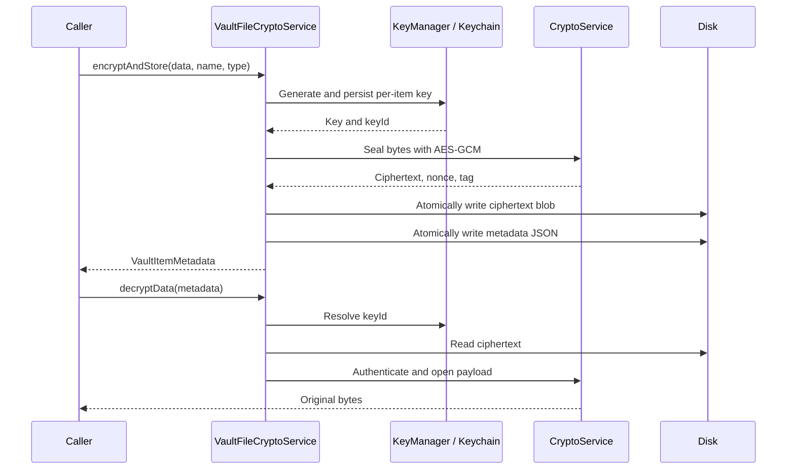

# Local encryption architecture

## Service boundaries

| Type | Responsibility |
| --- | --- |
| `CryptoService` | Generate AES keys, seal data, and open authenticated ciphertext |
| `KeychainService` | Store/read/delete key bytes using a service and account namespace |
| `KeyManager` | Assign per-item key identifiers and resolve them back to symmetric keys |
| `VaultFileCryptoService` | Coordinate file import, encryption, metadata, decryption, and deletion |
| `VaultItemMetadata` | Describe an item and its encryption parameters |
| `ContentView` | Current SwiftUI starter screen; no vault UI is wired yet |

## On-disk format

```text
Application Support/
└── Vault/
    ├── encrypted/<item-id>.vault
    └── metadata/<item-id>.json
```

The `.vault` file contains ciphertext only. JSON metadata contains the algorithm label, key identifier, nonce, tag, display name, original content type, byte count, and creation date. `Data` fields are base64-encoded by the JSON encoder; dates use ISO 8601. Metadata is readable JSON, not an encrypted envelope.

Keys are stored separately as generic-password items under the default Keychain service `com.secure-vault.filekeys`. Each item's account is its generated key UUID. The configured accessibility is `kSecAttrAccessibleWhenUnlockedThisDeviceOnly`; the implementation does not configure biometric access control or key synchronization.

## Write and read paths



The two atomic file writes and the Keychain operation are separate operations, not a transaction. The current code has no rollback/reconciliation for partial writes. Treat metadata as input when adding a user-facing file browser.

## Plaintext ownership

`decryptData` returns bytes in memory. `decryptToTemporaryFile` writes a plaintext file in the temporary directory and transfers cleanup responsibility to the caller. `importFile` keeps its source by default; with `removingSource: true`, source removal is best-effort and its errors are ignored.

Deletion removes the per-item key after attempting to remove ciphertext and metadata. It does not verify secure erasure of filesystem blocks, remove external copies of the original, or manage caller-created previews. No backup/recovery or key migration flow is implemented.

## Test scope

The checked-in XCTest suites cover crypto authentication failures, Keychain CRUD behavior, encrypted persistence, metadata reload, and normal deletion. They use sample bytes and temporary files. They do not cover a complete application UX, biometric unlock, failure-atomic storage, large-file streaming, or a formal security review.
